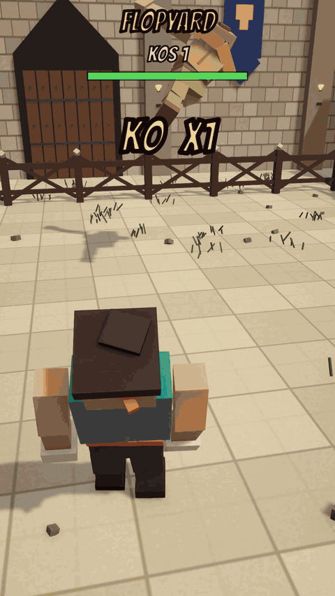
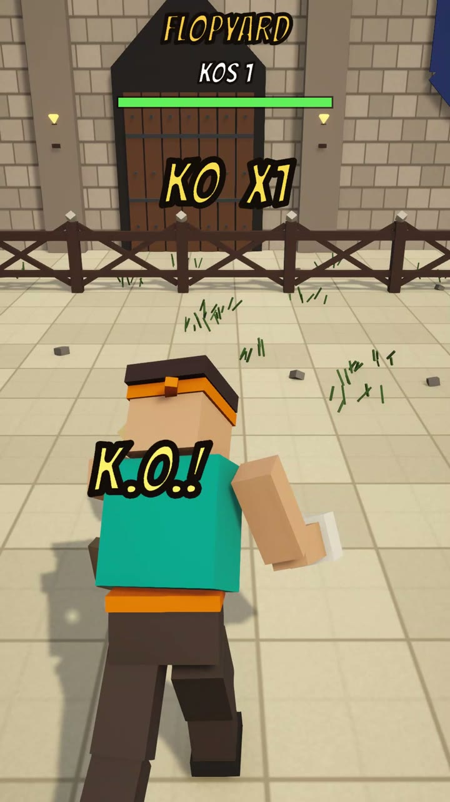
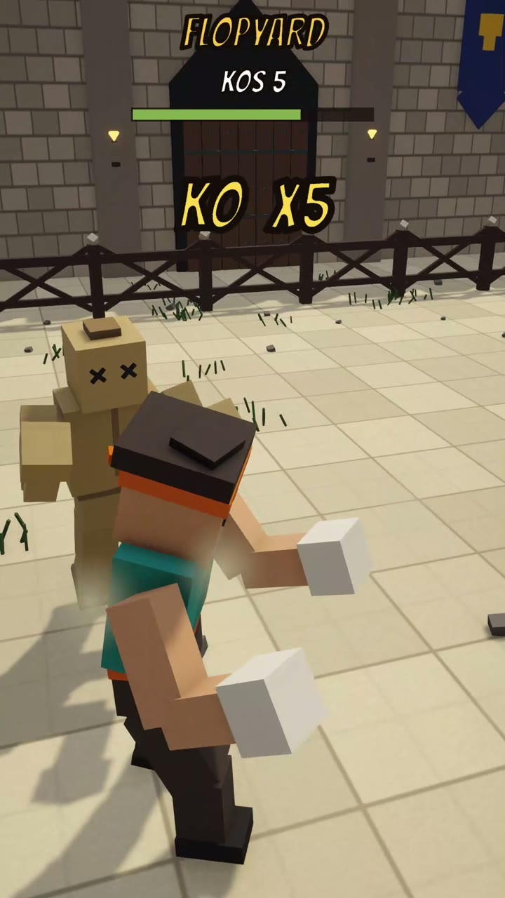

# Flopyard

A wobbly physics-ragdoll brawler in a sunny stone courtyard: walk up, swing punches and high kicks, and send floppy sparring opponents flying.

  
  

## How to play

The camera sits behind your fighter's shoulder and turns toward the nearest opponent.

| Action | Keyboard / mouse | Gamepad |
|---|---|---|
| Move | WASD or arrow keys | Left stick |
| Punch (alternates hands) | Left mouse, J or Space | West button |
| High kick | Right mouse or K | North button |
| Get up when knocked down | Hold any direction | Left stick |
| Restart | R | |

**Goal:** knock out as many opponents as you can. Burlap sparring sacks and red-vest brutes keep walking in through the gate, more of them as your KO count rises. Every fighter is a physics ragdoll held up by muscles: big hits knock you down, the courtyard drains to grey and you have to hold a direction to stagger back up. Lose all your health and the run restarts.

## How to open it

1. Unity **6000.5.4f1** (Unity 6.5) with the Universal Render Pipeline. Open the folder in Unity Hub.
2. Open the scene `Assets/Flopyard/Flopyard.unity`.
3. Press Play. The courtyard, fighters, camera and HUD are all built from code at start.

## Created by Satura Space

This game was made with [Satura Space](https://github.com/saturadev/satura-space) ([saturaspace.com](https://saturaspace.com)), free and open source. A TikTok link, a physics-fighting clip by [@the_big_g_studio](https://www.tiktok.com/@the_big_g_studio/video/7703226519786769694), was pasted into Satura Space. A Claude agent watched the clip's frames, searched GitHub for how others build active ragdolls, built the game in Unity from primitives and code, playtested it with a bot and filmed it.

## Model and cost

Claude Opus 5.5, low effort, in Claude Code. At Anthropic API list prices the run would have cost about **$4.83** (estimate at API prices, all sessions for this game). Tokens: 140 input, 77,360 output, 9,580,621 cache read, 171,114 cache write.

## Credits

- Joint-target maths adapted from [sergioabreu-g/active-ragdolls](https://github.com/sergioabreu-g/active-ragdolls) (`ConfigurableJointExtensions` by Michael Stevenson), Apache License 2.0. Balance idea (upright torque) from the same project.
- Font: [Bangers](https://github.com/googlefonts/bangers), SIL Open Font License 1.1.
- Inspired by a clip by [@the_big_g_studio](https://www.tiktok.com/@the_big_g_studio/video/7703226519786769694). Flopyard's name, characters and art are its own.

Game code and art: MIT, see [LICENSE](LICENSE).
